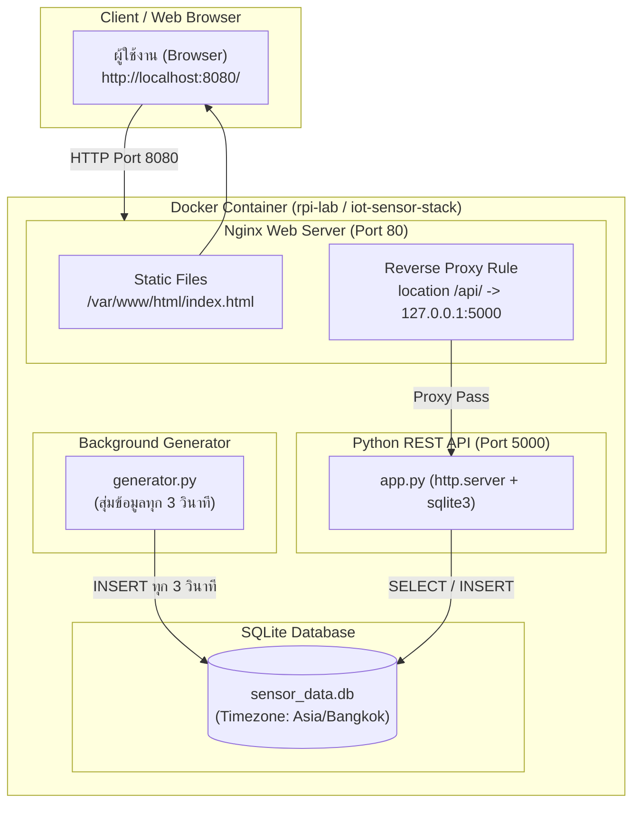

# 🚀 งาน #7: Docker + Nginx + SQLite IoT Stack

[](https://www.docker.com/)
[](https://nginx.org/)
[](https://www.sqlite.org/)
[](https://www.python.org/)

โปรเจกต์จำลองระบบประมวลผลและติดตามข้อมูลเซนเซอร์ IoT ตามหลักสูตร **Linux Lab** (LAB 11 - Nginx Web Server และ LAB 12 - SQLite Database จาก [zorkia.github.io/linux](https://zorkia.github.io/linux/))

---

## 📌 คุณสมบัติเด่น (Features)

1. **Python Data Generator (`generator.py`):**
   - สุ่มข้อมูลเซนเซอร์ IoT (อุณหภูมิ, ความชื้น, สถานะ, รหัสอุปกรณ์) อัตโนมัติทุก 3 วินาที
   - บันทึกลงฐานข้อมูล SQLite (`sensor_logs`)
   - ประทับเวลาประเทศไทย (**Asia/Bangkok, UTC+7**) ในทุกระเบียนข้อมูล
2. **Python Web API (`app.py`):**
   - พัฒนาด้วย Python Standard Library (`http.server` + `sqlite3`) ตามมาตรฐาน LAB 12 โดยไม่ต้องติดตั้ง pip เพิ่มเติม
   - บริการ Endpoint:
     - `GET /api/logs?limit=30` : ดึงรายการบันทึกเซนเซอร์ล่าสุด
     - `GET /api/stats` : สรุปสถิติล่าสุด (อุณหภูมิเฉลี่ย, สูงสุด, จำนวนบันทึกทั้งหมด, คำเตือน)
     - `GET /api/health` : ตรวจสอบสถานะการทำงานของระบบ
     - `POST /api/logs` : รับข้อมูลเซนเซอร์จากภายนอกเข้าสู่ระบบ
3. **Nginx Web Server & Reverse Proxy:**
   - ให้บริการหน้าเว็บ Static Dashboard ทางพอร์ต 80 (Map สู่โฮสต์พอร์ต 8080)
   - ทำหน้าที่ Reverse Proxy ส่งต่อคำขอ `/api/` ไปยัง Python Backend (`127.0.0.1:5000`)
   - เพิ่ม Security Headers (nosniff, SAMEORIGIN, server_tokens off)
4. **Modern Web Dashboard (`index.html` & `app.js`):**
   - หน้าจอ Dashboard สไตล์ทันสมัย รองรับ Responsive ทั้งคอมพิวเตอร์และมือถือ
   - ระบบ **Auto-refresh ทุก 3 วินาที** พร้อมตัวเลขนับถอยหลัง (Countdown) และปุ่มพักชั่วคราว/รีเฟรชทันที
   - นาฬิกา Live Clock แสดงวันและเวลาประเทศไทย (พ.ศ. / ICT)
   - การ์ดสถิติตัวเลข (Metrics Cards) และตารางข้อมูลล่าสุดแบบ Real-time พร้อม Color Badges แยกสถานะชัดเจน

---

## 🏗️ สถาปัตยกรรมของระบบ (Architecture)



---

## 📂 โครงสร้างไดเรกทอรี (Project Structure)

```text
docker-nginx-sqlite-iot/
├── backend/
│   ├── app.py                  # Python REST API Server (Port 5000)
│   └── generator.py            # สคริปต์สุ่มข้อมูลเซนเซอร์ทุก 3 วินาที
├── data/
│   └── .gitkeep                # โฟลเดอร์เก็บฐานข้อมูล SQLite (Persistent Volume)
├── nginx/
│   ├── default.conf            # Nginx Configuration (Reverse Proxy + Static Files)
│   └── html/
│       ├── index.html          # หน้าเว็บ Dashboard Auto-refresh
│       ├── status.html         # สำเนาสำหรับรองรับ URL /status.html ตาม LAB 12
│       └── app.js              # JavaScript ควบคุมการดึง API และแสดงเวลาไทย
├── scripts/
│   ├── entrypoint.sh           # สคริปต์เริ่มต้นระบบใน Docker
│   └── rpi_lab_setup.sh        # สคริปต์ติดตั้งและรันใน container rpi-lab
├── Dockerfile                  # Docker Image Specification (Debian Trixie)
├── docker-compose.yml          # Docker Compose สำหรับรันด้วยคำสั่งเดียว
└── README.md                   # เอกสารประกอบโครงการ
```

---

## 🚀 วิธีการติดตั้งและรันใช้งาน

### วิธีที่ 1: รันด้วย Docker Compose (แนะนำ - สะดวกและรวดเร็ว)

เหมาะสำหรับการรันและทดสอบระบบทั้งหมดในคำสั่งเดียว:

1. Clone หรือเปิดโฟลเดอร์โปรเจกต์:
   ```bash
   cd docker-nginx-sqlite-iot
   ```
2. สั่งเริ่มระบบด้วย Docker Compose:
   ```bash
   docker compose up --build -d
   ```
3. เปิดเบราว์เซอร์เข้าใช้งาน:
   - **Dashboard หน้าหลัก:** [http://localhost:8080](http://localhost:8080)
   - **หรือ URL ตาม LAB 12:** [http://localhost:8080/status.html](http://localhost:8080/status.html)
   - **ทดสอบ API ข้อมูล:** [http://localhost:8080/api/logs](http://localhost:8080/api/logs)
   - **ทดสอบ API สถิติ:** [http://localhost:8080/api/stats](http://localhost:8080/api/stats)
4. การหยุดระบบ:
   ```bash
   docker compose down
   ```

---

### วิธีที่ 2: รันภายใน Container `rpi-lab` ตามคู่มือ LAB 11-12

หากต้องการทำตามขั้นตอนของรายวิชาบน Container `rpi-lab` (Debian Trixie):

1. สตาร์ทและเข้าสู่ Container `rpi-lab`:
   ```bash
   docker start -ai rpi-lab
   ```
2. สลับเป็นผู้ใช้ `piuser` (หรือรันเป็น root ตาม LAB):
   ```bash
   su - piuser
   ```
3. ติดตั้งโปรแกรมที่จำเป็น:
   ```bash
   sudo apt update
   sudo apt install -y sqlite3 python3 curl nginx procps tzdata
   ```
4. สร้างโฟลเดอร์และวางไฟล์:
   ```bash
   mkdir -p ~/iot-data ~/iot-web
   ```
   คัดลอกไฟล์ `backend/app.py` และ `backend/generator.py` ไปไว้ที่ `~/iot-web/`
5. คัดลอกหน้าเว็บ Frontend และ Nginx Config:
   ```bash
   sudo cp nginx/html/* /var/www/html/
   sudo cp nginx/default.conf /etc/nginx/sites-available/default
   sudo ln -sf /etc/nginx/sites-available/default /etc/nginx/sites-enabled/default
   sudo nginx -t
   sudo nginx -s reload || sudo nginx
   ```
6. สั่งรัน Python API และ Generator แบบ Background:
   ```bash
   export DB_PATH="$HOME/iot-data/sensor_data.db"
   nohup python3 -u ~/iot-web/app.py >> ~/iot-web/api.log 2>&1 < /dev/null &
   nohup python3 -u ~/iot-web/generator.py >> ~/iot-web/generator.log 2>&1 < /dev/null &
   ```
7. ตรวจสอบการทำงาน:
   ```bash
   # ตรวจสอบ Process
   ps aux | grep -E 'python3|nginx'

   # ตรวจสอบข้อมูลใน SQLite
   sqlite3 ~/iot-data/sensor_data.db "SELECT * FROM sensor_logs ORDER BY id DESC LIMIT 5;"

   # เปิดดูหน้าเว็บจากเครื่อง Host
   http://localhost:8080/status.html
   ```

*(หรือสามารถสั่งรัน `./scripts/rpi_lab_setup.sh` ครั้งเดียวเพื่อทำขั้นตอนทั้งหมดโดยอัตโนมัติ)*

---

## 🔒 ผลการตรวจสอบความมั่นคงปลอดภัย (Security Audit)

ระบบนี้ได้รับการออกแบบและตรวจสอบความปลอดภัยตามหลักการ Defensive Coding:

- **SQL Injection Prevention:** ใช้ Parameterized Queries (`?`) ในคำสั่ง SQL ทุกจุด ทั้งในส่วน Generator และ API Handler
- **Input Sanitization & Validation:** มีการตรวจสอบชนิดข้อมูล ขนาด Payload สูงสุด (Max 16 KB) และจำกัดขอบเขตของพารามิเตอร์ `limit` ระหว่าง 1 ถึง 100 เพื่อป้องกัน Denial-of-Service (DoS)
- **XSS Protection:** ฝั่ง Frontend มีฟังก์ชัน `escapeHtml()` ทำการ Escape ข้อความทั้งหมดก่อนเรนเดอร์ลงใน DOM ป้องกัน Stored XSS
- **HTTP Security Headers:** Nginx และ Python API มีการตั้งค่า `X-Content-Type-Options: nosniff`, `X-Frame-Options: SAMEORIGIN` และปิด `server_tokens`
- **Graceful Shutdown:** มีการดักจับสัญญาณ `SIGINT` และ `SIGTERM` เพื่อปิด Connection และ Process อย่างปลอดภัย ไม่ทำให้ฐานข้อมูล SQLite เสียหาย

---

## 👨‍💻 ผู้พัฒนา
- รหัสวิชา / หัวข้อ: Linux Lab - Docker + Nginx + SQLite (งาน #7)
- GitHub Repository: [https://github.com/wiwatpromwihan/docker-nginx-sqlite-iot](https://github.com/wiwatpromwihan/docker-nginx-sqlite-iot)
- อ้างอิงเอกสาร: [Docker Linux Lab (zorkia.github.io/linux)](https://zorkia.github.io/linux/)
